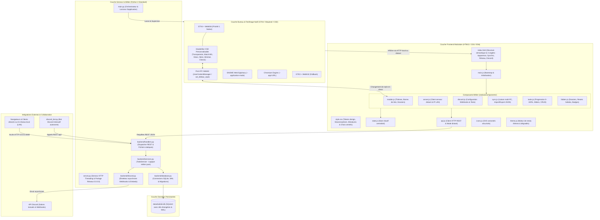

# ToDoList - Application de Bureau Locale, Réseau & Autonome

<p align="center">
  
</p>

<p align="center">
  <strong>Gestionnaire de tâches moderne, local et collaboratif avec fenêtrage natif dédié, suivi par progression, dossiers thématiques, synchronisation multi-PC, mode serveur réseau et intégration Discord en direct.</strong>
</p>

<p align="center">
  
  
  
  
  
  
  
  
</p>

---

## 🚀 Téléchargement & Installation Rapide

Installez et lancez **ToDoList** en quelques secondes sur votre machine Linux :

### 1. Télécharger le projet (Git Clone)

```bash
git clone https://github.com/HugoBirard/App-ToDoList.git
cd App-ToDoList
```

---

### 2. Installer les paquets système (selon votre distribution)

L'application utilise **Python 3**. Pour bénéficier du fenêtrage natif moderne (GTK4 / WebKit6 ou Epiphany), exécutez la commande adaptée à votre système :

#### 🔵 Fedora / Red Hat Enterprise Linux / CentOS (`sudo dnf`)
> **Note :** Sur Fedora et RHEL, le gestionnaire de paquets officiel est **`dnf`** (*Dandified YUM*, parfois abrégé ou confondu avec *dns*).
```bash
# Installation de Python, Pip et Git
sudo dnf install -y python3 python3-pip git

# (Recommandé) Paquets pour le fenêtrage natif GTK4 / WebKit et GNOME Web :
sudo dnf install -y python3-gobject gtk4 webkitgtk6.0 epiphany
```

#### 🟠 Ubuntu / Debian / Linux Mint / Pop!_OS (`sudo apt`)
```bash
# Mise à jour des dépôts et installation de Python, Pip, venv et Git
sudo apt update
sudo apt install -y python3 python3-pip python3-venv git

# (Recommandé) Paquets pour le fenêtrage natif GTK4 / WebKit et GNOME Web :
sudo apt install -y python3-gi python3-gi-cairo gir1.2-gtk-4.0 gir1.2-webkit-6.0 epiphany-browser
```

#### ⚪ Arch Linux / Manjaro (`sudo pacman`)
```bash
sudo pacman -S --needed python python-pip git gtk4 webkitgtk-6.0 epiphany
```

---

### 3. Installer les dépendances Python (`requirement.txt`)

Installez facilement toutes les dépendances de l'application et du bot Discord :

```bash
# 1. Créer et activer l'environnement virtuel (recommandé sous Linux)
python3 -m venv venv
source venv/bin/activate

# 2. Installer les bibliothèques
pip install -r requirement.txt
# (ou indifféremment : pip install -r requirements.txt)
```

---

### 4. Lancer ToDoList

Choisissez le mode de lancement qui convient à votre usage :

#### Mode A : Lancement direct de l'application
```bash
./start.sh
# ou directement :
python3 main.py
```

#### Mode B : Installer le raccourci dans vos Applications GNOME & Bureau
Installe automatiquement l'icône vectorielle officielle et le lanceur dans votre menu d'applications :
```bash
./installer-raccourci.sh
```

#### Mode C : Lancer en Mode Serveur d'Équipe (Multi-PC / Réseau local)
```bash
./lancer-serveur-equipe.sh
# ou personnaliser l'adresse et le port :
python3 server.py --host 0.0.0.0 --port 4848
```

---

## 🌿 Organisation des branches Git

Le dépôt est structuré en deux branches principales selon vos besoins :

- **`main` (Branche par défaut)** : Version **100% mono-utilisateur**, épurée, performante et sans friction. Elle se concentre sur l'organisation personnelle avec dossiers thématiques, personnalisation visuelle avancée, suivi par progression, Pause Café et sauvegardes locales SQLite.
- **`partage-salons`** : Version **multi-salons & collaborative** complète. Elle intègre la séparation des tâches par espaces/salons partagés, les invitations par code Discord et l'export/import ciblé de fichiers `.tdl`.

Pour basculer sur la version avec partage de salons :
```bash
git checkout partage-salons
```

---

## 📌 Présentation du projet

**ToDoList** est une application de bureau conçue pour les utilisateurs et équipes de projet recherchant la fluidité et l'élégance d'une application moderne (style **Spotify** ou **VS Code**), tout en conservant une **légèreté maximale**, une **confidentialité absolue** et des capacités puissantes de **travail collaboratif** :

- **Fenêtrage autonome dédié** : L'application ne s'ouvre **jamais** dans un onglet classique de navigateur avec barre d'URL. Elle dispose de sa propre fenêtre système isolée, de son icône dans le dock et se ferme proprement comme n'importe quel logiciel natif.
- **Zéro dépendance obligatoire (`Zero-Dependency`)** : Fonctionne directement avec la **bibliothèque standard Python 3** (`sqlite3`, `http.server`, `urllib`, `json`, `subprocess`). Zéro environnement lourd, zéro `npm install`, zéro `pip install` obligatoire pour le fonctionnement de base.
- **100% Locale & Privée par défaut** : Vos données restent exclusivement sur votre machine dans une base SQLite robuste. Aucune télémétrie, aucun compte obligatoire, fonctionne hors-ligne en continu.
- **Collaboration & Équipe intégrées** : Travaillez à plusieurs sur un projet grâce au **Mode Serveur Réseau en direct** et à l'**intégration Discord (Webhooks & Bot interactif)**.

---

## ✨ Caractéristiques principales

### 1. 🖥️ Fenêtrage natif autonome (Architecture de repli intelligente)
L'application orchestre un lancement fenêtré avec un système de fallback à 4 niveaux de priorité sous Linux :
1. **Priorité 1 — Fenêtre native GTK4 + WebKit6** : Intégration Wayland/X11 parfaite, processus isolé, aucun chrome de navigateur.
2. **Priorité 2 — GNOME Web (Epiphany) en mode application** : Moteur natif de bureau GNOME (`--application-mode`) avec profil isolé.
3. **Priorité 3 — Mode application Chromium / Chrome / Brave** : Lancement avec le drapeau `--app=http://127.0.0.1:<port>`.
4. **Priorité 4 — Fenêtre native GTK3 + WebKit2** : Compatibilité étendue pour les distributions antérieures.

*Le cycle de vie du serveur local est automatiquement synchronisé : fermer la fenêtre arrête le serveur proprement.*

### 2. 📁 Organisation par dossiers thématiques
- Classement par dossiers sur-mesure (ex: *Projets, Routine Quotidienne, Cours, Personnel*).
- Icône vectorielle SVG personnalisable par dossier (sélection d'icônes intégrées : classeur, mallette, cible, fusée, maison, etc.).
- Couleur d'accentuation dédiée et badges dynamiques affichant le nombre de tâches en attente.
- Vues rapides universelles : **Toutes les tâches**, **À faire**, **Terminées**.

### 3. 📊 Double mode de suivi : Case à cocher & Barre d'avancement (0 à 100%)
L'application propose deux manières complémentaires de suivre vos tâches, avec un dossier de démonstration **« Exemples & Découverte »** pré-chargé au premier démarrage :

| Mode | Affichage & Interaction | Cas d'usage idéal |
| :--- | :--- | :--- |
| **☑️ Case à cocher simple** | Case à cocher ergonomique à gauche du titre. Un clic coche ou décoche instantanément la tâche (titre barré et grisé). | Tâches binaires rapides (*ex: « Envoyer un e-mail », « Acheter du café », « Corriger le bug »*). |
| **📊 Barre d'avancement interactive** | Curseur coulissant (*slider*) fluide de 0% à 100% avec pas de 5%, boutons rapides **`+25%`** et **`100%`** et pourcentage en direct. | Tâches longues, projets, révisions (*ex: « Rédaction du rapport (50%) », « Développement module API »*). |

- **Bascule instantanée en 1 clic** : Chaque tâche dispose d'un bouton d'action dédié permettant de basculer à tout moment entre le mode case à cocher et le mode barre d'avancement sans perdre son état.
- **Règles de cohérence automatique** :
  - Déplacer le curseur jusqu'à **100%** (ou cliquer sur `100%`) coche automatiquement la tâche et la marque comme terminée.
  - Décocher une tâche terminée réinitialise sa progression à **0%**.
  - Abaisser la progression d'une tâche terminée en dessous de 100% la réactive automatiquement en état « À faire ».

### 4. 🔄 Réinitialisation hebdomadaire automatique (Habitudes & Routines)
- Activez l'option **"Reset hebdo automatique"** sur n'importe quel dossier (ex: ménage hebdomadaire, révision du week-end).
- Le backend calcule la différence de temps depuis la dernière réinitialisation (`last_reset_at + 7 jours`). Dès que le délai est atteint, les tâches du dossier repassent automatiquement à 0% et non cochées.
- Bouton de **réinitialisation manuelle instantanée** disponible à tout moment pour relancer une routine sans attendre les 7 jours.

### 5. 🎨 Univers Visuels, Subcultures, Fond Personnalisé & Barres GTK4
- **14 Thèmes & Ambiances complètes** au choix (avec décors et textures immersives, animations et styles de fenêtres assortis) :
  - **Univers Artistiques & Subcultures Immersifs** :
    - ⚡ **Streetwear & Acid Volt** (`street`) : Vrai fond texturé en mur de briques sombres avec tags au spray, coulures jaune volt #ccff00, stickers découpés et typographie street percutante.
    - 🌆 **Neo-Tokyo Cyberpunk** (`cyberpunk`) : Interface de hack façon mini-jeu Breach Protocol de Cyberpunk 2077 avec matrice de codes hexadécimaux (`BD E9 1C 55`), scanlines CRT, cartes biseautées HUD, lueur néon magenta et diodes cyan.
    - 🌋 **Lampe à Lave Magma** (`lava`) : Ambiance psychédélique et rétro 70s avec bulles de cire de lave en apesanteur, halo thermique rouge/orange incandescent (#ff5500) et formes organiques douces.
    - 🎛️ **Berlin Techno Warehouse** (`techno`) : Murs de béton brut industriel, colonnes de lasers blancs purs, typographie monospace et visualiseur audio VU-mètre monochrome.
    - 💿 **Chrome & Y2K Iridescent** (`y2k`) : Gouttes de métal liquide chromé, étoiles à 4 branches futuristes et reflets lilas métallisés de l'an 2000.
    - 🕹️ **80s Retro Synthwave** (`arcade`) : Grille 3D en perspective au sol façon Outrun/Tron, soleil couchant rétro strié et néon rose sunset.
    - 👑 **Midnight Gold Executive** (`luxury`) : Marbre noir d'ébène avec veines d'or 24 carats et finitions or brossé champagne haut de gamme.
    - 🌲 **Nordic Zen Mist** (`zen`) : Brume matinale sur l'eau, silhouettes de bambou estompées et vert thé matcha apaisant pour les yeux.
  - **Essentiels Pro & Épurés** :
    - 🖤 **Noir & Gris Pro** (`pro-dark`, défaut) : Glassmorphism équilibré et finitions soignées.
    - ⬛ **Carbone Pur** (`carbon`) : Noir mat profond et teintes titane.
    - 🌌 **Nébuleuse Nuit** (`midnight`) : Dégradé bleu nuit cosmique.
    - 🪨 **Ardoise Bleutée** (`slate`) : Nuance bleu acier élégante.
    - 🌿 **Émeraude Sombre** (`emerald`) : Teintes végétales profondes.
    - 🔮 **Améthyste Sombre** (`violet`) : Nuances pourpres nocturnes.
- **🖼️ Image de fond personnalisée** :
  - Les utilisateurs peuvent importer **n'importe quelle photo ou illustration personnelle** depuis leur ordinateur en un clic (optimisée et redimensionnée automatiquement pour conserver une fluidité parfaite à 60 FPS).
- **Personnalisation sur mesure** :
  - **Dégradé personnalisé** avec 2 couleurs et sélection de l'angle (45°, 90°, 135°, 180°).
  - **Couleur unie** avec nuancier direct.
  - **Fond individuel par dossier** pour distinguer immédiatement chaque projet.
- **Barres de titre système GTK4 CSD natives** : 14 styles de barres supérieures interchangeables en 1 clic dans l'application ou en argument CLI (`--titlebar street`, `cyberpunk`, `lava`, `techno`, `y2k`, `arcade`, `luxury`, `zen`, `transparent`, `match-bg`, `glass`, `neon`, `minimal`, `classic`).

### 6. ☕ Bouton Pause Café & Anti-Procrastination
- Bouton interactif dédié dans la barre supérieure de l'application.
- Déclenche un **carillon audio harmonieux** synthétisé nativement via l'API Web Audio (aucun fichier son externe lourd requis).
- Génère une **pluie animée d'émojis flottants** (☕, 🥐, ✨, 🍪, 🍩, 🍫) sur tout l'écran.
- Affiche une modale contenant une **punchline aléatoire humoristique** et un compteur de tasses dégustées.
- Fonctionnalité testée et validée pour prouver le bon fonctionnement du système de mise à jour en 1 clic.

### 7. 🌐 Synchronisation Multi-PC & Partage Cloud
- **Partagez facilement vos listes entre plusieurs PC** en sélectionnant un dossier synchronisé (Nextcloud, Dropbox, Syncthing, Google Drive ou partage réseau SMB/NFS).
- Configuration dans **Options & Paramètres > Liaison PC & Synchro** :
  - **Connecter** une base partagée existante (pour le second PC).
  - **Déplacer** vos listes actuelles vers le dossier partagé (pour le premier PC).
  - **Surveillance automatique en direct** : Toute modification apportée sur un autre PC est détectée et rafraîchie à l'écran automatiquement.
  - **Sauvegardes manuelles** : Export et Import / Restauration de fichiers de sauvegarde JSON.

### 8. 🚀 Mode Serveur Réseau (Partage d'équipe en direct)
- **Hébergez votre ToDoList en local ou sur votre réseau** : Un membre de l'équipe lance le serveur via `./lancer-serveur-equipe.sh`.
- **Connexion client distante** : Dans l'onglet **Serveur Réseau**, entrez l'adresse de l'hôte (ex : `http://192.168.1.35:4848`) et profitez d'une synchronisation en temps réel avec pastille de statut active.
- **Accès navigateur sans installation** : Tout collègue sur le réseau peut également ouvrir l'adresse directement dans son navigateur web (Chrome, Firefox, Safari).

### 9. 🎮 Intégration Discord (Webhooks & Bot interactif)
- **Notifications Webhook en direct** : Connectez votre salon Discord de projet (`#taches-projet`) pour recevoir des embeds stylisés à chaque création, validation ou suppression de tâche.
- **Bot Discord interactif (`discord_bot.py`)** : Permet à l'équipe de consulter, ajouter et terminer des tâches directement avec les commandes `!todo`, `!todo add <titre>` et `!todo done <id>`.

### 10. 💾 Persistance robuste SQLite ACID
- Base relationnelle locale stockée dans `data/todolist.db`.
- Activation explicite des clés étrangères (`PRAGMA foreign_keys = ON`) avec suppression en cascade.
- **Système de migrations automatiques non destructives** au démarrage de l'application.
- **Mode WAL (*Write-Ahead Logging*)** : Concurrence multi-processus fluide sans blocage de base.

### 11. 🛡️ Sécurité & Confidentialité durcies (Audit Complet)
L'application intègre une architecture de sécurité rigoureuse couvrant le backend et le frontend :
- **Authentification HMAC par Jeton Bearer** : Accès au mode serveur réseau protégé par jeton secret vérifié en temps constant (`hmac.compare_digest`).
- **CORS strict & Protection Anti-CSRF** : Aucun wildcard `*` ; validation d'origine stricte et rejet immédiat (`403 Forbidden`) des requêtes de mutation forgées depuis des sites tiers.
- **Contrôle d'accès IP sur routes Admin** : Les opérations sensibles (`/api/storage/*`, sélecteurs natifs, configuration) sont physiquement restreintes aux adresses locales (`127.0.0.1`, `::1`).
- **Masquage & Protection des Secrets Discord** : L'URL du webhook Discord n'est jamais exposée en clair dans les données ou sauvegardes exportées (`••••xxxx`) et ne peut être écrasée accidentellement.
- **Anti-XSS & Assainissement CSS** : Validation stricte des couleurs hexadécimales via regex CSS conforme (`_safe_color`), restriction de `bg_type` par liste blanche et sécurisation du DOM.
- **Protection Anti-DoS & Anti-SSRF** : Limitation stricte de charge utile à 5 Mo (`413 Payload Too Large`), requêtes HTTP vers Discord restreintes aux domaines officiels HTTPS.
- **En-têtes HTTP de durcissement** : `X-Content-Type-Options: nosniff`, `X-Frame-Options: DENY`, `Referrer-Policy: no-referrer`, `Cache-Control: no-store`.

---

## 🏗️ Architecture logicielle

Le projet est articulé selon une **architecture en couches découplée**, garantissant que chaque composant a une responsabilité unique (*Single Responsibility Principle*) :



### Arborescence détaillée du projet

```
App-ToDoList/
├── backend/                       # Couche logique serveur & bureau (Python)
│   ├── __init__.py                # Exports du package backend
│   ├── config.py                  # Chemins absolus, ports, détection IP locales et constantes
│   ├── database.py                # Gestionnaire de connexion SQLite & migrations de schéma
│   ├── discord.py                 # Module d'envoi asynchrone des Rich Embeds Discord (Webhooks)
│   ├── handlers.py                # Dispatcher d'API REST HTTP & serveur de fichiers statiques
│   ├── services.py                # Logique métier pure (CRUD, progression 100%, reset hebdo)
│   ├── updater.py                 # Système de mise à jour Git et sauvegardes préventives SQLite
│   ├── window.py                  # Gestionnaire et fallbacks de fenêtres natives autonomes
│   ├── window_gtk3.py             # Lanceur dédié GTK3 + WebKit2 (Fallback)
│   └── window_gtk4.py             # Lanceur dédié GTK4 + WebKit6 (HeaderBar CSD & CSS Provider dynamique)
│
├── static/                        # Couche interface utilisateur (ES6 Modules & CSS)
│   ├── index.html                 # Structure de la vue principale et modale à 4 onglets
│   ├── css/
│   │   └── style.css              # Variables CSS, design tokens, choix centrés & thèmes
│   ├── js/
│   │   ├── api.js                 # Client HTTP (fetch JSON, mode serveur distant, détection réseau)
│   │   ├── state.js               # Store d'état applicatif en mémoire
│   │   ├── icons.js               # Dictionnaire d'icônes vectorielles SVG sécurisées
│   │   ├── theme.js               # Moteur de génération des dégradés et couleurs
│   │   ├── main.js                # Point d'entrée frontend et liaisons d'événements
│   │   └── components/
│   │       ├── coffee.js          # Pause Café anti-procrastination (pluie d'émojis, carillon Web Audio)
│   │       ├── colorpicker.js     # Sélecteur de couleur intégré popover
│   │       ├── discord.js         # Interface et configuration des notifications Discord
│   │       ├── dropdowns.js       # Composant de listes déroulantes stylisées
│   │       ├── folders.js         # Gestion des dossiers, compteurs et resets
│   │       ├── modals.js          # Fenêtres modales (Création dossier, Thèmes & Styles de barre de titre)
│   │       ├── server.js          # Gestion du client serveur distant et affichage des IP LAN
│   │       ├── sync.js            # Gestion de la synchronisation Multi-PC & onglets
│   │       ├── tasks.js           # Rendu des tâches, barres de progression, inline edit
│   │       └── updater.js         # Gestionnaire de mise à jour in-app en 1 clic
│   └── assets/
│       ├── icon.png               # Icône PNG 256x256 pour le système
│       └── icon.svg               # Icône vectorielle SVG
│
├── tests/                         # Suite de tests unitaires, d'intégration et de sécurité (56/56)
│   ├── __init__.py                # Package tests
│   ├── test_database.py           # Validation du schéma SQLite et des migrations
│   ├── test_services.py           # Validation des règles métier (100% = fait, reset hebdo, reorder)
│   ├── test_handlers.py           # Validation des routes API REST et détection réseau
│   ├── test_discord.py            # Validation anti-SSRF, format des embeds et déclencheurs
│   ├── test_titlebar.py           # Validation des styles de HeaderBar, parsing CLI et CSS GTK4
│   ├── test_security.py           # 17 tests de sécurité (Auth HMAC, CORS, Admin IP, XSS, DoS 413)
│   └── test_updater.py            # Validation des mises à jour 1 clic et sauvegardes préventives SQLite
│
├── data/                          # Données applicatives persistantes
│   ├── .gitkeep                   # Maintien du dossier dans git
│   └── todolist.db                # Base de données SQLite locale (ignorée par git)
│
├── .gitignore                     # Exclusion des fichiers temporaires, logs et DB
├── discord_bot.py                 # Bot Discord interactif autonome (!todo, !todo add, !todo done)
├── installer-raccourci.sh         # Script d'installation du raccourci système GNOME/Bureau
├── lancer-serveur-equipe.sh       # Script de démarrage du serveur d'équipe partagé sur le réseau
├── LICENSE                        # Licence open source MIT
├── main.py                        # Lanceur principal (Orchestrateur Serveur + Fenêtre GUI)
├── pyproject.toml                 # Métadonnées de packaging Python standard (PEP 621)
├── README.md                      # Documentation complète du projet
├── requirement.txt                # Dépendances Python rapides (certifi, discord.py, PyGObject)
├── requirements.txt               # Fichier standard des dépendances (alias identique)
├── requirements-dev.txt           # Dépendances de développement & tests (flake8, pytest)
├── server.py                      # Lanceur de serveur HTTP autonome (options --host, --port, --share, --token)
├── start.sh                       # Script bash exécutable de démarrage rapide
└── ToDoList.desktop               # Raccourci standard pour environnements de bureau Linux (XDG)
```

---

## 💻 Compatibilité & Systèmes supportés

| Système / Environnement | Mode recommandé | Statut | Détails |
| :--- | :--- | :---: | :--- |
| **Ubuntu / Debian / Linux Mint / Pop!_OS** | Fenêtre native GTK4 ou GNOME Web | ✅ **100% Supporté** | Intégration Wayland & X11, raccourci bureau et menu des applications |
| **Fedora / RHEL / CentOS Stream** | Fenêtre native GTK4 ou GNOME Web | ✅ **100% Supporté** | Prise en charge native complète avec `python3-gobject` et `gtk4` |
| **Arch Linux / Manjaro / EndeavourOS** | Fenêtre native GTK4 ou WebKit | ✅ **100% Supporté** | Support complet via paquets officiels Arch |
| **Environnements de Bureau (DE)** | GNOME, KDE Plasma, XFCE, Cinnamon, MATE | ✅ **100% Supporté** | Fichier `.desktop` standard compatible freedesktop.org / XDG |
| **Gestionnaires de fenêtres Tiling** | i3, Sway, Hyprland, bspwm | ✅ **Supporté** | S'ouvre comme une fenêtre client Wayland/X11 standard |
| **Windows 10 / 11 (via WSL2 + WSLg)** | Fenêtre native graphique | ✅ **Supporté** | Fonctionne nativement avec l'affichage graphique WSLg |
| **Windows / macOS (hors WSL)** | Mode Serveur Web Local ou Distant | 🌐 **Supporté** | Exécution avec `python3 server.py` dans Chrome/Firefox/Safari/Edge |

---

## 🚀 Guide d'installation et de démarrage rapide

### Étape 1 : Cloner le dépôt

```bash
git clone git@github.com:HugoBirard/App-ToDoList.git
cd App-ToDoList
```

---

### Étape 2 : Installer les bibliothèques d'affichage recommandées (selon votre distribution)

L'application ne requiert **aucun paquet tiers Python** (`pip`). Pour profiter de la fenêtre native GTK4 dédiée de haute qualité :

#### 🔹 Ubuntu, Debian, Linux Mint, Pop!_OS
```bash
sudo apt update
sudo apt install -y python3 python3-gi gir1.2-gtk-4.0 gir1.2-webkit-6.0
```

#### 🔹 Fedora
```bash
sudo dnf install -y python3 python3-gobject gtk4 webkitgtk6.0
```

#### 🔹 Arch Linux, Manjaro
```bash
sudo pacman -S --needed python python-gobject gtk4 webkit2gtk-6.0
```

> [!TIP]
> **Vous n'avez pas les droits `sudo` ?**  
> L'application bascule automatiquement sur GNOME Web (`epiphany`), Chrome/Chromium (`--app`), ou le mode serveur local sans aucune intervention de votre part.

---

### Étape 3 : Installer le raccourci système (1 clic)

Exécutez le script d'installation automatique :
```bash
./installer-raccourci.sh
```

Ce script configure l'icône vectorielle, rend tous les lanceurs exécutables et installe le raccourci dans vos applications GNOME et sur votre Bureau.

---

### Étape 4 : Lancer l'application

Vous disposez de 3 modes selon votre usage :

#### Mode A : Application de Bureau native (Recommandé)
```bash
./start.sh
```
*(Ou tapez `ToDoList` dans le lanceur d'applications de votre système).*

> **Personnalisation de la barre de titre système (GTK4 / Wayland) :**
> Vous pouvez prévisualiser ou forcer le style de la barre supérieure directement au lancement ou dans l'onglet **Options ⚙️ > Apparence** :
> ```bash
> # Nouveaux Univers Artistiques & Subcultures
> ./start.sh --titlebar street       # Streetwear Acid Volt (Jaune fluo découpé & bold)
> ./start.sh --titlebar cyberpunk    # Neo-Tokyo Cyberpunk (Bordure néon magenta & lueur cyan)
> ./start.sh --titlebar lava         # Lampe à Lave Magma (Lueur incandescente orange & ambre)
> ./start.sh --titlebar techno       # Berlin Techno Laser (Ligne blanche ultra-fine & boutons carrés)
> ./start.sh --titlebar y2k          # Chrome & Y2K Iridescent (Métal liquide lilas & reflets)
> ./start.sh --titlebar arcade       # 80s Retro Synthwave (Coucher de soleil magenta & arcade)
> ./start.sh --titlebar luxury       # Midnight Gold Executive (Or brossé champagne & onyx)
> ./start.sh --titlebar zen          # Nordic Zen Mist (Vert matcha doux & brume)
>
> # Essentiels Pro & Épurés
> ./start.sh --titlebar transparent  # Transparente & intégrée (Style Spotify / Discord)
> ./start.sh --titlebar match-bg     # Même couleur sombre que le fond actif de l'application
> ./start.sh --titlebar glass        # Verre fumé translucide avec reflets (Glassmorphism)
> ./start.sh --titlebar neon         # Liseré cyber indigo lumineux avec halo néon
> ./start.sh --titlebar minimal      # Barre compacte (28px) sans titre pour un écran 100% utile
> ./start.sh --titlebar classic      # Thème système standard GNOME Adwaita
> ```

#### Mode B : Serveur d'Équipe partagé sur le réseau local
Pour permettre à vos camarades de projet de se connecter à votre ToDoList :
```bash
./lancer-serveur-equipe.sh
# ou : python3 server.py --share
```
L'écran affiche vos adresses IP réseau (ex : `http://192.168.1.35:4848`).

#### Mode C : Mode Serveur Local Headless
```bash
python3 server.py --port 4848
```
Puis accédez à `http://localhost:4848` dans votre navigateur.

---

## 🔄 Mises à jour du logiciel (1 Clic & Zéro Perte de Données)

ToDoList intègre un système moderne de mise à jour automatique en arrière-plan :

### 1. Notification In-App en direct (Recommandé)
- Dès qu'une nouvelle version ou des correctifs sont publiés sur GitHub, une **bannière de notification** apparaît discrètement en haut de l'application :
  > **🚀 Nouvelle version disponible !** Des nouveautés et améliorations sont prêtes à être installées. `[ Mettre à jour en 1 clic ]`
- Vous pouvez également vérifier manuellement à tout moment dans **Options (⚙️) > Mises à jour**.
- Un clic sur **« Mettre à jour en 1 clic »** télécharge les nouveautés, met à jour vos raccourcis et vous propose de relancer l'application immédiatement.

### 2. En ligne de commande (Terminal)
Exécutez simplement le script dédié :
```bash
./update.sh
```
*(Ou manuellement : `git pull && ./installer-raccourci.sh`)*.

> [!IMPORTANT]
> **Vos données sont 100% protégées** :  
> Le processus de mise à jour crée automatiquement une copie de sauvegarde préventive (`data/todolist.db.pre-update.bak`). Vos tâches, dossiers et notes personnelles ne sont **jamais écrasés ni supprimés**.

---

## 🌐 Guide d'utilisation collaborative (Projet d'Équipe)

### 1. Se connecter au serveur ToDoList d'un collègue
1. Ouvrez votre application ToDoList.
2. Cliquez sur la roue dentée **Options (⚙️) > Serveur Réseau**.
3. Renseignez l'adresse IP fournie par votre collègue (ex : `http://192.168.1.35:4848`).
4. Cliquez sur **Tester**, puis sur **Se connecter à ce serveur**.
5. Une pastille lumineuse bleue s'affiche en haut de l'écran pour confirmer la connexion en direct !

### 2. Intégration Discord (Webhooks en direct)
1. Dans votre salon Discord de projet (ex : `#taches-projet`), faites un clic droit > *Modifier le salon* > *Intégrations* > *Webhooks* > *Nouveau Webhook* > *Copier l'URL du Webhook*.
2. Dans ToDoList, allez dans **Options (⚙️) > Discord & Équipe**.
3. Cochez **« Activer les notifications Discord »**, collez l'URL et entrez votre pseudo.
4. Cliquez sur **« Envoyer un message test »** pour vérifier immédiatement la liaison !

### 3. Bot Discord Interactif (`discord_bot.py`)
Permet à votre équipe de piloter les tâches sans quitter Discord :

```bash
# Installation des dépendances (ou pip install -r requirement.txt)
pip install -r requirement.txt

# Démarrage du bot avec votre Token
python3 discord_bot.py --token "VOTRE_TOKEN_BOT"
```

| Commande Discord | Action réalisée |
| :--- | :--- |
| `!todo` ou `!todo list` | Affiche toutes les tâches ouvertes du projet classées par dossier |
| `!todo add <titre>` | Crée immédiatement une tâche dans l'application ToDoList |
| `!todo done <id>` | Marque la tâche `#id` comme complétée |
| `!todo folders` | Affiche la liste des dossiers du projet |
| `!todo help` | Affiche l'aide des commandes |

---

## 🧪 Tests & Qualité du code

Le projet intègre une suite complète de tests unitaires et de sécurité validée avec le module standard `unittest` :

```bash
python3 -m unittest discover tests -v
```

### Périmètre des tests automatisés (56/56 tests passés)
| Fichier de test | Domaine testé | Statut |
| :--- | :--- | :---: |
| `tests/test_database.py` | Schéma SQLite, contraintes de clés étrangères, migrations et initialisation des exemples (case à cocher + progression) | ✅ Passé |
| `tests/test_services.py` | Règle de complétion 100%, décochage 0%, réorganisation dossiers, calcul reset à 7 jours | ✅ Passé |
| `tests/test_handlers.py` | Routes API REST, validation des identifiants, codes HTTP, détection réseau et sécurité | ✅ Passé |
| `tests/test_discord.py` | Validation anti-SSRF, format des Rich Embeds, déclencheurs d'événements | ✅ Passé |
| `tests/test_titlebar.py` | Styles de HeaderBar, parsing arguments CLI, compatibilité parseur CSS GTK4 | ✅ Passé |
| `tests/test_security.py` | Authentification Bearer HMAC, CORS/Origin, routes admin locales, masquage secrets, anti-XSS et limite 413 | ✅ Passé |
| `tests/test_updater.py` | Détection de mise à jour, sauvegarde SQLite préventive `.pre-update.bak`, gestion non-Git et erreurs réseau | ✅ Passé |

---

## 📡 Spécification de l'API REST

L'application expose une API REST légère servant du JSON en UTF-8 :

| Méthode | Route | Description |
| :--- | :--- | :--- |
| `GET` | `/api/data` | Récupère tous les dossiers, tâches et paramètres (vérifie les resets hebdo) |
| `GET` | `/api/system/update-status` | Vérifie si une mise à jour distante est disponible (Git upstream / commits) |
| `POST` | `/api/system/apply-update` | Applique la mise à jour (sauvegarde SQLite préventive, git pull, raccourcis) |
| `POST` | `/api/folders` | Crée un nouveau dossier (`name`, `icon`, `color`, `auto_reset_weekly`, `bg_*`) |
| `PUT` | `/api/folders/<id>` | Met à jour les propriétés ou le style d'un dossier |
| `DELETE` | `/api/folders/<id>` | Supprime un dossier et cascade la suppression de ses tâches |
| `POST` | `/api/folders/<id>/reset` | Réinitialise manuellement toutes les tâches du dossier à 0% et non terminées |
| `POST` | `/api/tasks` | Crée une nouvelle tâche (`title`, `folder_id`, `has_progress`, `progress`, etc.) |
| `PUT` | `/api/tasks/<id>` | Met à jour une tâche (cochage, modification de progression, renommage) |
| `DELETE` | `/api/tasks/<id>` | Supprime définitivement une tâche |
| `POST` | `/api/tasks/clear-completed` | Supprime toutes les tâches terminées (globalement ou pour un dossier donné) |
| `PUT` | `/api/settings` | Enregistre un paramètre global (ex : `main_background`, réglages Discord) |
| `POST` | `/api/discord/test` | Teste l'envoi d'un message sur un webhook Discord |
| `GET` | `/api/network/info` | Retourne les adresses IP locales et URLs réseau de la machine hôte |
| `GET` | `/api/sync/status` | Retourne l'état actuel du fichier de stockage |
| `GET` | `/api/sync/check-updates` | Retourne l'horodatage de modification du fichier pour la synchro automatique |
| `POST` | `/api/storage/change-path` | Modifie ou connecte un nouvel emplacement de base de données |
| `POST` | `/api/storage/browse` | Ouvre un sélecteur de fichier natif pour choisir la base partagée |
| `GET` | `/api/storage/export` | Exporte toutes les données sous forme de fichier JSON |
| `POST` | `/api/storage/import` | Importe ou fusionne un fichier de sauvegarde JSON |

---

## 🛠️ Dépannage & FAQ

<details>
<summary><strong>Sous GNOME, le double-clic sur le Bureau ne lance pas l'application ?</strong></summary>

Sous certaines versions de GNOME, le bureau requiert une autorisation explicite au premier lancement :
1. Faites un **clic droit** sur l'icône `ToDoList.desktop` sur votre bureau.
2. Cliquez sur **« Autoriser le lancement »** (*Allow Launching*).
3. L'icône de l'application s'affiche immédiatement et le double-clic fonctionne.
</details>

<details>
<summary><strong>Comment changer le port réseau par défaut ?</strong></summary>

Par défaut, l'application utilise le port `4848`. Si ce port est occupé, elle sélectionne automatiquement le port libre suivant (4849, 4850, ...). Vous pouvez également forcer un port manuellement :
```bash
python3 server.py --port 5050
```
</details>

<details>
<summary><strong>Où sont sauvegardées mes données ?</strong></summary>

Toutes vos données (dossiers, tâches, progression, préférences de thèmes et réglages) sont sauvegardées localement dans :
```
data/todolist.db
```
Ce fichier est une base de données standard SQLite. Vous pouvez sauvegarder ce fichier, le déplacer vers un dossier cloud (Dropbox, Nextcloud, Google Drive) ou le partager en réseau local.
</details>

---

## 📄 Licence

Ce projet est distribué sous licence open source **MIT**. Consultez le fichier [LICENSE](LICENSE) pour plus d'informations.
