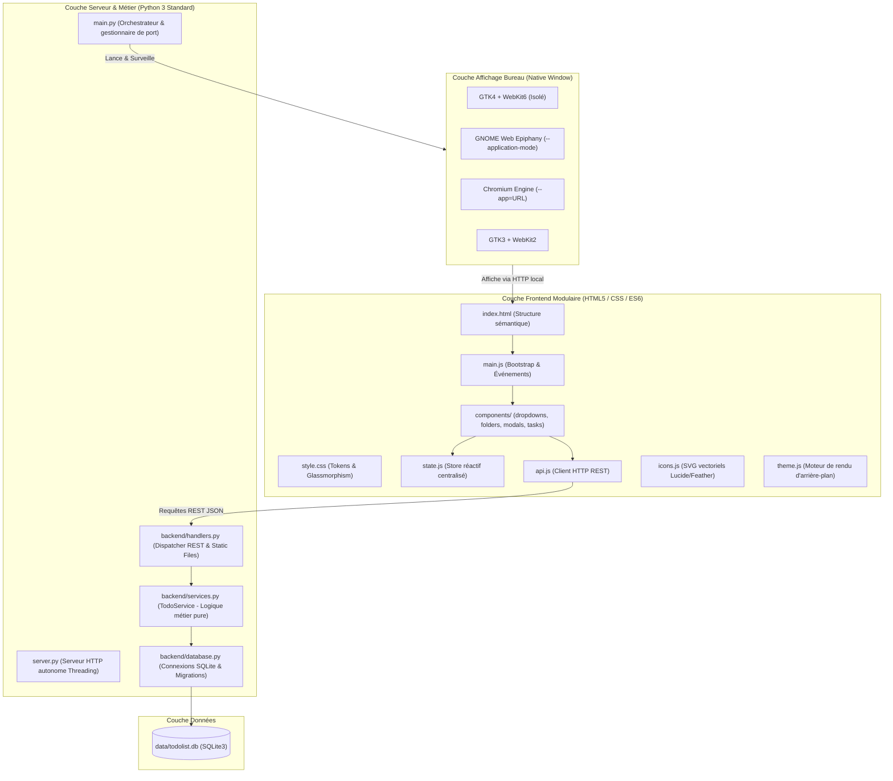

# ToDo List - Application de Bureau Locale & Autonome

<p align="center">
  
</p>

<p align="center">
  <strong>Gestionnaire de tâches moderne, local et persistant avec fenêtrage natif dédié, suivi par progression, dossiers thématiques et réinitialisations hebdomadaires intelligentes.</strong>
</p>

<p align="center">
  
  
  
  
  
</p>

---

## 📌 Présentation du projet

**ToDo List** est une application de bureau conçue pour les utilisateurs recherchant la fluidité et l'élégance d'une application moderne (style **Spotify** ou **VS Code**), tout en conservant une **légèreté maximale** et une **confidentialité absolue** :

- **Fenêtrage autonome dédié** : L'application ne s'ouvre **jamais** dans un onglet classique de navigateur avec barre d'URL. Elle dispose de sa propre fenêtre système isolée, de son icône dans le dock et se ferme proprement comme n'importe quel logiciel natif.
- **Zéro dépendance externe (`Zero-Dependency`)** : Fonctionne directement avec la **bibliothèque standard Python 3** (`sqlite3`, `http.server`, `urllib`, `json`, `subprocess`). Zéro environnement lourd, zéro `npm install`, zéro `pip install` obligatoire.
- **100% Locale & Privée** : Vos données restent exclusivement sur votre machine dans une base SQLite robuste. Aucune télémétrie, aucun compte obligatoire, fonctionne hors-ligne en continu.

---

## ✨ Caractéristiques principales

### 1. 🖥️ Fenêtrage natif autonome (Architecture de repli intelligente)
L'application orchestre un lancement fenêtré avec un système de fallback à 4 niveaux de priorité sous Linux :
1. **Priorité 1 — Fenêtre native GTK4 + WebKit6** : Intégration Wayland/X11 parfaite, processus isolé, aucun chrome de navigateur.
2. **Priorité 2 — GNOME Web (Epiphany) en mode application** : Moteur natif de bureau GNOME (`--application-mode`) avec profil isolé.
3. **Priorité 3 — Mode application Chromium / Chrome / Brave** : Lancement avec le drapeau `--app=http://127.0.0.1:<port>`.
4. **Priorité 4 — Fenêtre native GTK3 + WebKit2** : Compatibilité étendue pour les distributions antérieures.

*Le cycle de vie du serveur local est automatiquement synchronisé : fermer la fenêtre arrête le serveur proprement.*

### 2. 📁 Organisation par dossiers thématiques
- Classement par dossiers sur-mesure (ex: *Projets, Routine Quotidienne, Cours, Personnel*).
- Icône vectorielle SVG personnalisable par dossier (sélection d'icônes intégrées : classeur, mallette, cible, code, maison, etc.).
- Couleur d'accentuation dédiée et badges dynamiques affichant le nombre de tâches en attente.
- Vues rapides universelles : **Toutes les tâches**, **À faire**, **Terminées**.

### 3. 📊 Suivi fin par barre de progression (0 à 100%)
- Chaque tâche peut être configurée avec ou sans progression.
- Curseur coulissant (*slider*) interactif en temps réel avec affichage du pourcentage exact.
- **Règles de cohérence automatique** :
  - Atteindre **100%** marque automatiquement la tâche comme complétée.
  - Décocher une tâche terminée réinitialise sa progression à **0%**.
  - Abaisser la progression d'une tâche terminée sous 100% la replace automatiquement dans l'état « À faire ».

### 4. 🔄 Réinitialisation hebdomadaire automatique (Habitudes & Routines)
- Activez l'option **"Reset hebdo automatique"** sur n'importe quel dossier (ex: ménage hebdomadaire, révision du week-end).
- Le backend calcule la différence de temps depuis la dernière réinitialisation (`last_reset_at + 7 jours`). Dès que le délai est atteint, les tâches du dossier repassent automatiquement à 0% et non cochées.
- Bouton de **réinitialisation manuelle instantanée** disponible à tout moment pour relancer une routine sans attendre les 7 jours.

### 5. 🎨 Thèmes & Arrière-plans sur-mesure
- **Thème Sombre Pro** par défaut, aux finitions soignées (glassmorphism, bordures semi-transparentes).
- Personnalisation complète de l'arrière-plan principal ou par dossier :
  - **Dégradé personnalisé** avec 2 couleurs et sélection de l'angle (45°, 90°, 135°, 180°).
  - **Couleur unie**.
  - Presets prêts à l'emploi (Noir & Gris Pro, Bleu Nuit, Violet Moderne, Vert Émeraude, etc.).

### 6. 🎛️ Composants d'interface sur mesure
- **Listes déroulantes personnalisées (Custom Dropdowns)** : Remplacement complet des éléments `<select>` natifs du système d'exploitation par des menus stylisés en CSS/JS avec flèches SVG et bordures translucides.
- Édition rapide du titre en double-cliquant sur une tâche.
- Nettoyage en 1 clic des tâches terminées d'un dossier.
- Dialogues de confirmation personnalisés pour éviter toute suppression involontaire.

### 7. 💾 Persistance robuste SQLite ACID
- Base relationnelle locale stockée dans `data/todolist.db`.
- Activation explicite des clés étrangères (`PRAGMA foreign_keys = ON`) avec suppression en cascade.
- **Système de migrations automatiques non destructives** au démarrage de l'application (ajout dynamique des colonnes manquantes sans risque de perte de données).

---

## 🏗️ Architecture logicielle

Le projet est articulé selon une **architecture en couches découplée**, garantissant que chaque composant a une responsabilité unique (*Single Responsibility Principle*) :



### Arborescence détaillée du projet

```
App-ToDoList/
├── backend/                       # Couche logique serveur & bureau (Python)
│   ├── __init__.py                # Exports du package backend
│   ├── config.py                  # Chemins absolus, ports et constantes globales
│   ├── database.py                # Gestionnaire de connexion SQLite & migrations de schéma
│   ├── handlers.py                # Dispatcher d'API REST HTTP & serveur de fichiers statiques
│   ├── services.py                # Logique métier pure (CRUD, 100% progress, weekly reset)
│   ├── window.py                  # Gestionnaire et fallbacks de fenêtres natives autonomes
│   ├── window_gtk3.py             # Lanceur dédié GTK3 + WebKit2
│   └── window_gtk4.py             # Lanceur dédié GTK4 + WebKit6 (prioritaire)
│
├── static/                        # Couche interface utilisateur (ES6 Modules & CSS)
│   ├── index.html                 # Structure de la vue principale et des modales
│   ├── css/
│   │   └── style.css              # Variables CSS, design tokens, responsive & thèmes
│   ├── js/
│   │   ├── api.js                 # Client HTTP (fetch JSON, gestion d'erreurs)
│   │   ├── state.js               # Store d'état applicatif en mémoire
│   │   ├── icons.js               # Dictionnaire d'icônes vectorielles SVG sécurisées
│   │   ├── theme.js               # Moteur de génération des dégradés et couleurs
│   │   ├── main.js                # Point d'entrée frontend et liaisons d'événements
│   │   └── components/
│   │       ├── dropdowns.js       # Composant de listes déroulantes stylisées
│   │       ├── folders.js         # Gestion des dossiers, compteurs et resets
│   │       ├── modals.js          # Fenêtres modales (Création dossier & Thèmes)
│   │       └── tasks.js           # Rendu des tâches, barres de progression, inline edit
│   └── assets/
│       ├── icon.png               # Icône PNG 256x256 pour le système
│       └── icon.svg               # Icône vectorielle SVG
│
├── tests/                         # Suite de tests unitaires et d'intégration
│   ├── __init__.py                # Package tests
│   ├── test_database.py           # Validation du schéma SQLite et des migrations
│   ├── test_services.py           # Validation des règles métier (100% = fait, reset hebdo)
│   └── test_handlers.py           # Validation des routes API REST et codes HTTP
│
├── data/                          # Données applicatives persistantes
│   ├── .gitkeep                   # Maintien du dossier dans git
│   └── todolist.db                # Base de données SQLite locale (ignorée par git)
│
├── .gitignore                     # Exclusion des fichiers temporaires, logs et DB
├── installer-raccourci.sh         # Script d'installation du raccourci système GNOME/Bureau
├── LICENSE                        # Licence open source MIT
├── main.py                        # Lanceur principal (Orchestrateur Serveur + Fenêtre GUI)
├── pyproject.toml                 # Métadonnées de packaging Python standard (PEP 621)
├── README.md                      # Documentation complète du projet
├── server.py                      # Lanceur de serveur HTTP direct / headless
├── start.sh                       # Script bash exécutable de démarrage rapide
└── ToDoList.desktop               # Raccourci standard pour environnements de bureau Linux (XDG)
```

---

## 💻 Compatibilité & Systèmes supportés

| Système / Environnement | Mode recommandé | Statut | Détails |
| :--- | :--- | :---: | :--- |
| **Ubuntu / Debian / Linux Mint / Pop!_OS** | Fenêtre native GTK4 ou GNOME Web | ✅ **100% Supporté** | Intégration Wayland & X11, raccourci bureau et menu des applications |
| **Fedora / RHEL / CentOS Stream** | Fenêtre native GTK4 ou GNOME Web | ✅ **100% Supporté** | Prise en charge native complète avec `python3-gobject` et `gtk4` |
| **Arch Linux / Manjaro / EndeavourOS** | Fenêtre native GTK4 ou WebKit | ✅ **100% Supporté** | Support complet via paquets officiels Arch |
| **Environnements de Bureau (DE)** | GNOME, KDE Plasma, XFCE, Cinnamon, MATE | ✅ **100% Supporté** | Fichier `.desktop` standard compatible freedesktop.org / XDG |
| **Gestionnaires de fenêtres Tiling** | i3, Sway, Hyprland, bspwm | ✅ **Supporté** | S'ouvre comme une fenêtre client Wayland/X11 standard |
| **Windows 10 / 11 (via WSL2 + WSLg)** | Fenêtre native graphique | ✅ **Supporté** | Fonctionne nativement avec l'affichage graphique WSLg |
| **Windows / macOS (hors WSL)** | Mode Serveur Web Local | 🌐 **Supporté** | Exécution avec `python3 server.py` dans Chrome/Firefox/Safari/Edge |

---

## 🚀 Guide d'installation pas-à-pas

### Étape 1 : Cloner le dépôt

Ouvrez un terminal et clonez le dépôt GitHub :

```bash
git clone git@github.com:HugoBirard/App-ToDoList.git
cd App-ToDoList
```

*(Ou téléchargez et extrayez l'archive ZIP du projet puis ouvrez un terminal dans le dossier extrait).*

---

### Étape 2 : Installer les composants recommandés (selon votre distribution)

L'application ne requiert **aucun paquet tiers Python** (`pip`). Pour profiter de la **fenêtre native GTK4 dédiée de haute qualité**, installez simplement les bibliothèques d'affichage de votre distribution :

#### 🔹 Ubuntu, Debian, Linux Mint, Pop!_OS
```bash
sudo apt update
sudo apt install -y python3 python3-gi gir1.2-gtk-4.0 gir1.2-webkit-6.0
```

#### 🔹 Fedora
```bash
sudo dnf install -y python3 python3-gobject gtk4 webkitgtk6.0
```

#### 🔹 Arch Linux, Manjaro
```bash
sudo pacman -S --needed python python-gobject gtk4 webkit2gtk-6.0
```

#### 🔹 openSUSE
```bash
sudo zypper install python3-gobject typelib-Gtk-4_0 typelib-WebKit-6_0
```

> [!TIP]
> **Vous n'avez pas les droits `sudo` ou utilisez un autre système ?**
> Aucun problème ! L'application dispose d'un **système de repli automatique intelligent** :
> 1. Si GTK4 n'est pas présent, elle cherche **GNOME Web** (`epiphany`).
> 2. Sinon, elle cherche **Google Chrome**, **Chromium** ou **Brave** et s'ouvre en mode application (`--app`).
> 3. Sinon, elle utilise **GTK3**.
> 4. Vous pouvez aussi simplement lancer le serveur web local (`python3 server.py`) sans rien installer.

---

### Étape 3 : Installer le raccourci système (1 clic)

Exécutez le script d'installation automatique :

```bash
./installer-raccourci.sh
```

Ce script effectue automatiquement toutes les configurations nécessaires :
1. Rend exécutables tous les lanceurs (`start.sh`, `main.py`, `server.py`).
2. Détecte le chemin absolu du dossier sur votre disque et configure dynamiquement le fichier `ToDoList.desktop`.
3. Installe le raccourci dans votre menu d'applications GNOME (`~/.local/share/applications/todolist.desktop`).
4. Dépose un raccourci directement sur votre **Bureau** (si le dossier Bureau ou Desktop existe) et configure la confiance Nautilus.

---

### Étape 4 : Lancer l'application

Vous disposez de 3 manières simples de lancer l'application :

#### Méthode A : Depuis vos applications système (Comme Spotify)
- Appuyez sur la touche `Super` (Windows) de votre clavier.
- Tapez **"ToDo List"**.
- Cliquez sur l'icône de l'application ! Vous pouvez faire un clic droit pour l'épingler à votre dock / favoris.

#### Méthode B : En ligne de commande ou double-clic
```bash
./start.sh
```

#### Méthode C : Mode serveur web (Headless)
Pratique pour les serveurs, machines distantes ou navigateurs classiques :
```bash
python3 server.py --port 4848
```
Puis accédez à l'interface depuis n'importe quel navigateur : `http://localhost:4848`.

---

## 🛠️ Dépannage & FAQ

<details>
<summary><strong>Sous GNOME, le double-clic sur le Bureau ne lance pas l'application ?</strong></summary>

Sous certaines versions de GNOME, le bureau requiert une autorisation explicite au premier lancement :
1. Faites un **clic droit** sur l'icône `ToDoList.desktop` sur votre bureau.
2. Cliquez sur **« Autoriser le lancement »** (*Allow Launching*).
3. L'icône de l'application s'affichera immédiatement et le double-clic fonctionnera !
</details>

<details>
<summary><strong>Comment changer le port réseau par défaut ?</strong></summary>

Par défaut, l'application utilise le port `4848`. Si ce port est déjà occupé, elle sélectionne automatiquement le premier port libre consécutif (4849, 4850, ...). Vous pouvez également forcer un port manuellement :
```bash
python3 server.py --port 5050
```
</details>

<details>
<summary><strong>Où sont sauvegardées mes données ?</strong></summary>

Toutes vos données (dossiers, tâches, progression, préférences de thèmes) sont sauvegardées localement dans le fichier :
```
data/todolist.db
```
Ce fichier est une base de données standard SQLite. Vous pouvez sauvegarder ce fichier pour conserver vos tâches ou le copier sur un autre ordinateur.
</details>

---

## 🧪 Tests & Qualité du code

Le projet comprend une suite complète de tests unitaires et d'intégration couvrant la base de données, la logique métier et l'API HTTP, utilisant exclusivement le module standard `unittest` de Python :

```bash
python3 -m unittest discover tests
```

Pour exécuter avec vérification stricte des avertissements :
```bash
python3 -W error -m unittest discover tests
```

### Périmètre des tests
| Fichier de test | Domaine testé |
| :--- | :--- |
| `tests/test_database.py` | Création des tables, index, clés étrangères, intégrité des migrations de colonnes |
| `tests/test_services.py` | Règle de complétion à 100%, décochage à 0%, détection de l'échéance de 7 jours pour le reset hebdo |
| `tests/test_handlers.py` | Endpoints API REST (`GET /api/data`, `POST /api/folders`, `POST /api/tasks`, validation, codes 200/201/400/404) |

---

## 📡 Spécification de l'API REST

L'application expose une API REST légère et prédictible servant du JSON en UTF-8 :

| Méthode | Route | Description |
| :--- | :--- | :--- |
| `GET` | `/api/data` | Récupère tous les dossiers, tâches et paramètres (vérifie au passage les resets hebdo) |
| `POST` | `/api/folders` | Crée un nouveau dossier (`name`, `icon`, `color`, `auto_reset_weekly`, `bg_*`) |
| `PUT` | `/api/folders/<id>` | Met à jour les propriétés ou le style d'un dossier |
| `DELETE` | `/api/folders/<id>` | Supprime un dossier et cascade la suppression de ses tâches |
| `POST` | `/api/folders/<id>/reset` | Réinitialise manuellement toutes les tâches du dossier à 0% et non terminées |
| `POST` | `/api/tasks` | Crée une nouvelle tâche (`title`, `folder_id`, `has_progress`, `progress`, etc.) |
| `PUT` | `/api/tasks/<id>` | Met à jour une tâche (cochage, modification de progression, renommage) |
| `DELETE` | `/api/tasks/<id>` | Supprime définitivement une tâche |
| `POST` | `/api/tasks/clear-completed` | Supprime toutes les tâches terminées (globalement ou pour un `folder_id` donné) |
| `PUT` | `/api/settings` | Enregistre un paramètre global (ex: `main_background`) |

---

## 📄 Licence

Ce projet est distribué sous licence open source **MIT**. Consultez le fichier [LICENSE](LICENSE) pour plus d'informations.
